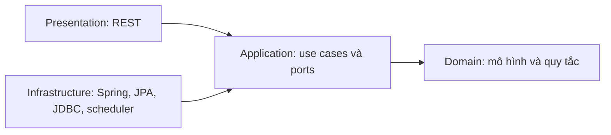

# Kiến trúc backend

Backend áp dụng Onion Architecture trong một Maven module. Chiều phụ thuộc được kiểm tra trên bytecode bằng `OnionArchitectureTest`:

Mã Java nằm dưới `backend/src/main/java/com/example/analyzeproject/`:

| Package | Trách nhiệm |
| --- | --- |
| `domain/model` | Mô hình kỳ quay, vé, tham số và dữ liệu feed; không có annotation JPA. |
| `domain/service` | Chọn revision đủ chất lượng, học quan hệ theo thời gian, rank fusion, danh mục vé và các phép thống kê thuần Java. Không phụ thuộc Spring, Jackson hoặc các lớp bên ngoài. |
| `application/service` | Use case dự đoán, backtest, snapshot, workspace, báo cáo, nhập và đối soát kết quả. Chỉ truy cập lưu trữ qua output ports. |
| `application/dto` | Request/response và hợp đồng snapshot dùng bởi application và REST. |
| `application/port/out` | Các interface repository/store và khóa ghi khi nhập kết quả. Không kế thừa Spring Data. |
| `application/port/in` | Hợp đồng đọc trạng thái đồng bộ. Các service application là điểm gọi use case còn lại. |
| `application/exception` | Lỗi xung đột nghiệp vụ, không chứa mã trạng thái HTTP. |
| `infrastructure/persistence/entity` | JPA entities và converter audit JSON; giữ entity name và mapping bảng cũ. |
| `infrastructure/persistence/jpa` | Spring Data repositories, adapter cho output ports và mapper sao chép dữ liệu domain/entity. |
| `infrastructure/persistence/jdbc` | Adapter ledger/workspace; giữ SQL, transaction, advisory lock và chính sách lưu bất biến. |
| `infrastructure/persistence` | Decorator transaction cho báo cáo và nhập kết quả. |
| `infrastructure/config` | Cấu hình database và `ApplicationConfig`, nơi lắp ghép các use case với adapter. |
| `infrastructure/sync`, `infrastructure/scheduling` | HTTP feed client, cấu hình đồng bộ và các tác vụ Spring scheduler. |
| `presentation/rest`, `presentation/config` | HTTP controllers, ánh xạ lỗi, routing SPA và static assets. |

`AnalyzeProjectApplication` là entry point Spring Boot. Không đặt Spring stereotype, scheduling, transaction hay HTTP exception trong domain/application. Khi thêm adapter mới, implement output port rồi nối vào composition root; không đưa implementation vào constructor của use case.

Application vẫn dùng Jackson cho các hợp đồng JSON, patch tham số và SHA-256 của snapshot. Giữ nguyên thứ tự/kiểu dữ liệu khi serialize để không đổi ý nghĩa hash và retry payload. Domain không biết cách serialize hoặc lưu dữ liệu.

Mapper phải giữ mọi trường API, ID, timestamp, thứ tự số chính và audit JSON. Sao chép collection/audit ở cả hai chiều để thay đổi domain không vô tình làm thay đổi entity đang được JPA quản lý. Không trả JPA entity từ application.

`TransactionalLotteryResultImporter` bao toàn bộ lượt nhập và khóa advisory trong cùng transaction. `TransactionalDrawAnalysisService` mở transaction chỉ đọc với isolation `REPEATABLE_READ` cho cả báo cáo và dò vé. Không bỏ các override của decorator: đây là các điểm Spring áp dụng transaction lên use case thuần Java. Scheduler giữ nguyên khoảng chạy và gọi các use case đã được wiring.

Đường dẫn API và cấu trúc JSON được giữ nguyên. `ConflictException` được REST chuyển thành HTTP 409 với trường `message`. Không thay migration, dữ liệu lịch sử, ranking hoặc quy tắc cutoff. Di chuyển package thay bytecode nên fingerprint `codeVersion` của snapshot mới thay đổi; snapshot cũ không bị sửa và các cohort phiên bản tiếp tục được đánh giá riêng.

## Kiểm chứng

Từ `backend/`, chạy `mvn test` hoặc `mvn clean install`. Các kiểm thử mới kiểm tra chiều phụ thuộc, ánh xạ dữ liệu, HTTP 409 và wiring/transaction thực tế. Khi thay code ứng dụng vẫn build Angular trước Maven theo quy ước dự án.

`OnionPersistencePostgresTest` dùng cùng `WORKSPACE_TEST_JDBC` / `WORKSPACE_TEST_USER` với các kiểm thử PostgreSQL hiện có. Dùng database kiểm thử riêng, JDBC URL không có query và tài khoản được tạo/xóa schema. Test tự tạo schema ngẫu nhiên, chỉ lấy DDL từ V1/V3, áp dụng các migration schema ledger, rồi yêu cầu Hibernate `validate`; không cho Hibernate tạo hoặc sửa bảng và không nhập seed lịch sử. Test kiểm tra JPA adapters, quality/audit, transaction proxy, nhập idempotent và rollback trước khi xóa schema riêng đó.
