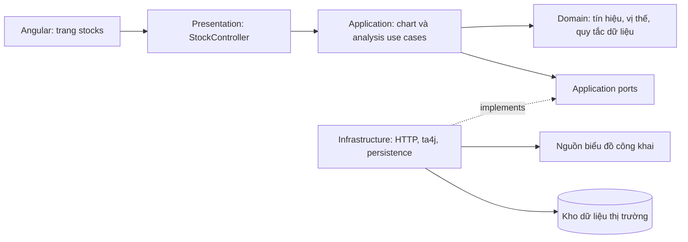

# Kế hoạch trang phân tích chứng khoán Việt Nam

Ngày lập: 02/11/2026. Trạng thái: kế hoạch triển khai, chưa thay code ứng dụng.

Yêu cầu đã chốt: trang mới cho VIC, FPT, SZC, MBB; biểu đồ nến mới nhất có thể lấy; người dùng nhập thời điểm và giá mua để nhận phân tích; có cả hai lựa chọn **Trong ngày** và **Vài tuần đến vài tháng**. Thư viện miễn phí, mã nguồn mở; nguồn dữ liệu không cần đăng ký tài khoản hoặc API key.

## 1. Phạm vi và kết quả người dùng nhận được

- Route `/stocks`, có thể mở trực tiếp `/stocks/FPT`; mục menu “Chứng khoán Việt Nam”. Giữ shell Header / Left menu / Content hiện có, ẩn bộ chọn MEGA/POWER và lịch xổ số trên route chứng khoán.
- Danh sách ban đầu gồm đúng bốn mã VIC, FPT, SZC, MBB. Catalog cấu hình được để mở rộng sau. VNINDEX là chỉ số tham chiếu thị trường, không phải mã thứ năm trong danh mục cổ phiếu.
- Hai chế độ phân tích có cấu hình, lịch sử và kết quả đánh giá riêng. Đổi khung hiển thị biểu đồ không âm thầm đổi chiến lược.
- Tách **tín hiệu thị trường** và **nhận định vị thế của tôi**. Giá mua ảnh hưởng lãi/lỗ, ngưỡng chịu lỗ và kịch bản thoát vị thế; không tự biến cổ phiếu đang giảm thành cơ hội mua thêm.
- Nhận định có các trạng thái “Cân nhắc mua”, “Giữ”, “Theo dõi”, “Cân nhắc giảm/bán”, “Chưa đủ dữ liệu”, kèm lý do và điều kiện làm nhận định thay đổi.
- Bản đầu tập trung phân tích kỹ thuật giá–khối lượng và quản trị vị thế. Phân tích báo cáo tài chính, tin tức và định giá doanh nghiệp là phần mở rộng sau, cần nguồn riêng.

| Nội dung | Trong ngày | Vài tuần đến vài tháng |
| --- | --- | --- |
| Khung phân tích mặc định | Nến 15 phút đã đóng | Nến ngày đã đóng |
| Khung xem biểu đồ | 15 phút; thêm 5 phút/1 giờ sau kiểm tra nguồn | Ngày, tuần; tháng nếu đủ lịch sử |
| Lịch sử mục tiêu | Tối thiểu đủ warm-up; mục tiêu 20–60 phiên tùy khả năng nguồn | 3–5 năm nếu nguồn có, ít nhất đủ khoảng 250 nến ngày cho cấu hình dài hạn |
| Nhóm chỉ báo | EMA9/21, RSI14, ATR14, khối lượng; VWAP khi đủ dữ liệu phiên | EMA20, SMA50/200, RSI14, MACD12/26/9, ATR14, khối lượng |
| Ý nghĩa | Theo dõi nhịp giá và điểm vào/thoát trong phiên | Theo dõi xu hướng và vùng mua/giảm tỷ trọng |
| Đánh giá hiệu quả | Backtest riêng theo phiên và khả năng bán thực tế | Backtest riêng theo ngày, tính chi phí và thời gian nắm giữ |

Chế độ “Trong ngày” không mặc định rằng cổ phiếu vừa mua đã được phép bán cùng ngày. Gợi ý thực hiện phải xét số lượng sẵn có và lịch thanh toán được xác minh khi triển khai. Không xây chức năng đặt lệnh trong phạm vi trang phân tích.

## 2. Thư viện và nguồn dữ liệu

| Thành phần | Phương án | Căn cứ / giới hạn |
| --- | --- | --- |
| Biểu đồ | TradingView Lightweight Charts | Miễn phí, Apache-2.0; hỗ trợ nến, volume, đường chỉ báo. Giữ NOTICE và attribution/link theo hướng dẫn chính thức. Thư viện không cung cấp giá thị trường. |
| Chỉ báo | `ta4j-core` 0.17, bọc sau `IndicatorEngine` port | MIT; POM tag 0.17 target Java 11, phù hợp làm ứng viên cho Java 17 hiện có. Kiểm tra compile, công thức và dependency khi tích hợp; không lấy bản mới nhất yêu cầu Java cao hơn một cách tự động. |
| HTTP / lưu trữ | Spring/Java HTTP client và PostgreSQL hiện có | Adapter Java trực tiếp; không cần thêm Python service hoặc dịch vụ AI có phí. |
| Dữ liệu chính dự kiến | Endpoint biểu đồ công khai DNSE/Entrade | Đã thử truy cập không tài khoản/key thành công. Là nguồn thực nghiệm, chưa có xác nhận giấy phép dữ liệu mở, SLA hoặc quota công khai cho endpoint này. |

Lightweight Charts có hướng dẫn [cài đặt và attribution](https://tradingview.github.io/lightweight-charts/docs), [giới thiệu giấy phép Apache-2.0](https://www.tradingview.com/lightweight-charts/). ta4j có [MIT LICENSE](https://github.com/ta4j/ta4j/blob/0.17/LICENSE) và [POM 0.17](https://github.com/ta4j/ta4j/blob/0.17/pom.xml) để đối chiếu phiên bản.

Nguồn dự kiến dùng HTTP GET từ backend:

```text
https://services.entrade.com.vn/chart-api/v2/ohlcs/stock
  ?symbol=FPT&resolution=15&from=<unix-seconds>&to=<unix-seconds>

https://services.entrade.com.vn/chart-api/v2/ohlcs/index
  ?symbol=VNINDEX&resolution=1D&from=<unix-seconds>&to=<unix-seconds>
```

Kiểm tra chỉ đọc trong phiên lập kế hoạch, không Authorization, không cookie đăng nhập, không giả header trình duyệt:

| Dữ liệu kiểm tra | Kết quả |
| --- | --- |
| VIC, FPT, SZC, MBB, mỗi mã ngày 30/10/2026, `1D` | HTTP 200, mỗi mã một nến |
| Bốn mã trên, cùng ngày, `15` | HTTP 200, mỗi mã 16 nến |
| VNINDEX qua `/index`, cùng ngày | HTTP 200 ở cả `1D` và `15` |
| FPT `1D`, 01/11/2023–30/10/2026 | HTTP 200, 746 nến |
| FPT ngày 02/11/2026, kiểm tra sau đóng cửa | HTTP 200, một nến ngày và 16 nến 15 phút; có dữ liệu phiên hiện tại |

Ví dụ truy vấn tái lập: [FPT 15 phút ngày 30/10](https://services.entrade.com.vn/chart-api/v2/ohlcs/stock?from=1793293200&to=1793379599&symbol=FPT&resolution=15), [FPT lịch sử ngày](https://services.entrade.com.vn/chart-api/v2/ohlcs/stock?from=1698771600&to=1793379599&symbol=FPT&resolution=1D). Response có các mảng `t/o/h/l/c/v` và `nextTime`; không tự khai báo chính sách điều chỉnh giá, đơn vị, độ trễ hoặc hạn mức.

Ở lượt kiểm tra FPT ngày 02/11, timestamp daily là 09:00; intraday đầu 09:15, cuối 14:45 giờ Việt Nam. Cần xác minh timestamp là đầu/cuối nến theo từng interval trước khi xác định `isClosed`. Có dữ liệu hôm nay sau đóng cửa không chứng minh độ trễ cập nhật trong phiên.

Kết quả thử chứng minh truy cập kỹ thuật tại thời điểm kiểm tra, chưa chứng minh dữ liệu đầy đủ, realtime hay được cấp quyền tái phân phối. Phần thư viện có giấy phép OSS; chưa xác minh được nguồn dữ liệu vừa không cần tài khoản vừa có giấy phép dữ liệu mở. Bước đầu triển khai phải kiểm tra quyền hiển thị/lưu trữ cho phạm vi sử dụng của trang. Không gọi khả năng truy cập công khai là quyền sử dụng không giới hạn.

SSI FastConnect không nằm trong phương án đã chọn vì [yêu cầu tài khoản SSI và API key](https://developers.ssi.com.vn/docs/faq/service-overview). Vnstock hiện hành không chọn làm dependency OSS vì [README chính thức](https://github.com/thinh-vu/vnstock/blob/main/README.md) ghi giấy phép riêng không theo chuẩn OSI và thế hệ 5 phân phối gói biên dịch. Không dùng giấy phép của phiên bản lịch sử để mô tả bản hiện hành.

Nếu endpoint công khai ngừng trả dữ liệu hoặc không đáp ứng quyền sử dụng cần thiết: giữ cache hợp lệ có nhãn thời điểm, trả trạng thái thiếu dữ liệu, và thay adapter sau khi tìm được nguồn đáp ứng cùng điều kiện không tài khoản. Không âm thầm chuyển sang API có phí/key. Nhập CSV là công cụ kiểm tra/lịch sử tùy chọn, không thay thế yêu cầu giá hiện tại.

## 3. Bố cục và luồng sử dụng

```text
Chứng khoán Việt Nam                 Nguồn / thời điểm cập nhật
[Trong ngày] [Vài tuần đến vài tháng]

[ VIC ] [ FPT ] [ SZC ] [ MBB ]       Bối cảnh VNINDEX

Biểu đồ nến + volume                 Tín hiệu thị trường
Khung xem / khoảng lịch sử           Xu hướng, lý do, vùng giá
EMA / SMA / dấu thời điểm mua        Trạng thái chất lượng dữ liệu

Vị thế của tôi                       Nhận định cho vị thế
Ngày mua / giờ mua nếu biết          Lãi/lỗ, giá hòa vốn
Giá mua VND / số lượng tùy chọn      Giữ / giảm / bán / theo dõi
Ngưỡng chịu lỗ tùy chọn              Điều kiện xác nhận hoặc đảo chiều
[Phân tích]

Chi tiết chỉ báo / phương pháp / đánh giá lịch sử
```

- Desktop: biểu đồ chiếm phần lớn chiều ngang; mobile: các khối xếp dọc, không tràn trang. Bảng chỉ báo không bắt người dùng đọc trước khi xem kết luận.
- Watchlist hiển thị giá mới nhất có nguồn xác minh, mức thay đổi theo giá tham chiếu phù hợp và timestamp. Nếu chỉ có close nến thì gọi đúng là “Giá đóng nến gần nhất”, không gắn nhãn giá khớp realtime.
- Nến đang hình thành hiển thị khác nến đã đóng. Trạng thái “Đang phiên / Nghỉ giữa phiên / Đóng cửa / Dữ liệu cũ / Mất kết nối” dựa vào lịch sàn và trạng thái nguồn.
- Đường giá mua và marker ngày mua phải cùng cơ sở giá với biểu đồ. Khi bật giá điều chỉnh, quy đổi marker đúng hệ số hoặc ẩn marker kèm giải thích; không đặt giá mua raw lên chuỗi adjusted.
- Mỗi kết luận có 2–4 lý do chính, vùng hỗ trợ/kháng cự, mốc cắt lỗ/chốt lời tham khảo khi đủ dữ liệu. Không dựng phần trăm “độ chính xác” hoặc “xác suất tăng” từ điểm chỉ báo.
- Kết quả có nhãn “Phân tích kỹ thuật tham khảo”; các vùng giá là kịch bản theo dữ liệu, không cam kết giá sẽ đến đó.

## 4. Dữ liệu vị thế và cách tính

Đầu vào bắt buộc khi phân tích vị thế: mã, ngày mua, giá mua dương theo VND/cổ phiếu. Giờ mua tùy chọn, lưu rõ độ chính xác ngày hay phút theo `Asia/Ho_Chi_Minh`; không tự bịa giờ khớp. Có thể phân tích thị trường khi chưa nhập vị thế.

Đầu vào mở rộng: số lượng, phí mua/bán dự kiến, ngưỡng lỗ tối đa và mục tiêu lợi nhuận. Bản đầu hỗ trợ một lô mua cho mỗi lần phân tích; nhiều lần mua và giá vốn bình quân là phần mở rộng. Số lượng có thể bán được dùng nếu cần biến tín hiệu thành gợi ý thao tác trong phiên.

- Chặn giá NaN/vô hạn/≤0, số lượng không hợp lệ, thời điểm mua tương lai. Giá khác vùng giá lịch sử thì cảnh báo kiểm tra đơn vị/cơ sở giá, không tự sửa giá người dùng.
- Không có số lượng: chỉ trả phần trăm thay đổi và chênh lệch trên mỗi cổ phiếu. Có số lượng: tính giá trị vốn, giá trị hiện tại và lãi/lỗ tiền.
- Cùng cơ sở giá, không có sự kiện quyền: `lãi/lỗ giá = (giá hiện tại - giá mua) × số lượng`; tỷ lệ giá = `giá hiện tại / giá mua - 1`.
- Lãi/lỗ ròng ước tính phải trừ phí mua, chi phí bán giả định và các khoản áp dụng theo cấu hình; thiếu khoản nào phải ghi “chưa tính …”, không mặc định đã gồm tất cả.
- Split, cổ phiếu thưởng, cổ tức tiền và quyền mua cần dữ liệu sự kiện cùng thông tin quyền thực nhận để tính tổng lợi nhuận. Không lấy chuỗi giá điều chỉnh chia thẳng giá mua raw. Nếu chưa đủ thông tin, đánh dấu lợi nhuận chưa điều chỉnh/không xác định và hạn chế kết luận phụ thuộc giá vốn.
- Ngày mua ngoài lịch sử đang có không cản việc xem tín hiệu hiện tại; không tái dựng nhận định tại thời điểm mua bằng dữ liệu không có.

Dự án hiện chưa có xác thực và ownership người dùng. MVP giữ dữ liệu nhập trong phiên trình duyệt, gọi POST tính toán không lưu vị thế vào bảng chung, không log payload vị thế. Nếu bổ sung “Lưu trên thiết bị này”, người dùng chủ động bật và có nút xóa. Lưu danh mục trên server/đồng bộ nhiều thiết bị là giai đoạn riêng có đăng nhập và phân quyền.

## 5. Thuật toán nhận định có thể giải thích

Luồng chung: kiểm tra chất lượng → chọn nến đã đóng đúng chế độ → tính chỉ báo → xác định xu hướng/bối cảnh → tạo tín hiệu thị trường → áp quy tắc vị thế → trả lý do và phiên bản.

| Nhóm | Thiết kế |
| --- | --- |
| Xu hướng | EMA/SMA và độ dốc; trạng thái tăng, giảm, đi ngang theo ngưỡng cấu hình |
| Động lượng | RSI và MACD xác nhận hoặc cảnh báo; không cộng nhiều điểm cho cùng một tín hiệu tương quan |
| Khối lượng | So sánh với cửa sổ trước; trong ngày cần xét nhịp khối lượng theo phiên. Không so volume một nến 15 phút với volume cả ngày |
| Vùng giá | High/low của cửa sổ nến đã đóng trước mốc đánh giá; không dùng pivot cần nến tương lai |
| Biến động | ATR theo đúng timeframe, khoảng cách đến hỗ trợ/kháng cự, tỷ lệ lợi nhuận/rủi ro nếu xác định được hai mốc |
| Bối cảnh | VNINDEX cùng mốc thời gian; chỉ mô tả thị trường qua chỉ số này, không gọi bốn cổ phiếu là độ rộng toàn thị trường |

VWAP chỉ hoạt động khi có dữ liệu đủ từ đầu phiên. Nếu tính xấp xỉ từ OHLCV dùng giá điển hình thì phải ghi là VWAP xấp xỉ, không trình bày như VWAP từ từng giao dịch. Thiếu phần đầu phiên thì bỏ chỉ báo này, không tự lấp dữ liệu.

Quy tắc ưu tiên đề xuất cho phiên bản đầu:

1. Dữ liệu quá cũ, thiếu nến warm-up, chuỗi giá chưa thống nhất hoặc quyền chưa xử lý → “Chưa đủ dữ liệu” cho phần phụ thuộc đó. Không cho phép điểm chỉ báo ghi đè lỗi dữ liệu.
2. Vị thế vi phạm ngưỡng rủi ro người dùng trên giá đủ mới → cảnh báo “Cân nhắc giảm/bán”, kèm giá dùng tính và khả năng bán đã biết/chưa biết.
3. Xu hướng tăng, tín hiệu xác nhận và vùng vào có tỷ lệ lợi nhuận/rủi ro đạt ngưỡng → “Cân nhắc mua” cho người chưa nắm giữ; vị thế có sẵn vẫn được đánh giá độc lập, không mặc định mua thêm.
4. Xu hướng còn phù hợp, chưa vi phạm ngưỡng rủi ro → “Giữ”. Xu hướng suy yếu/phá hỗ trợ được xác nhận → “Cân nhắc giảm/bán”. Các điều kiện xung đột → “Theo dõi”.
5. Chỉ báo quá mua/quá bán đơn lẻ không tự quyết định mua/bán. Giá đã lỗ không tự dẫn đến bình quân giá xuống.

Chu kỳ chỉ báo ở bảng là cấu hình khởi đầu phổ biến để kiểm thử, chưa là bộ tham số có hiệu quả được chứng minh. Chốt điều kiện, hệ số ATR, bộ lọc volume, ngưỡng lợi nhuận/rủi ro và quy tắc xử lý xung đột thành cấu hình phiên bản trước khi chạy đánh giá. Hai mode có `strategyVersion` riêng; backend trả rule đã kích hoạt, giá trị thực tế và ngưỡng để UI giải thích.

Tín hiệu xác nhận dùng nến đã đóng. Có thể hiển thị diễn biến nến đang chạy để tham khảo, nhưng không trộn với kết quả xác nhận hoặc backtest. Nếu sau này thêm nhận định “tại thời điểm mua”, toàn bộ chỉ báo và sự kiện phải giới hạn ở dữ liệu đã có khi đó.

## 6. Hợp đồng dữ liệu và độ mới

- Chuẩn hóa OHLC cổ phiếu thành VND, volume thành số cổ phiếu, VNINDEX thành điểm. Endpoint thử nghiệm trả giá cổ phiếu cỡ vài chục/vài trăm; phải đối chiếu để xác minh đơn vị, không áp hệ số 1.000 chỉ theo suy đoán giá lớn/nhỏ.
- Lưu `source`, `sourceTimestamp`, `fetchedAt`, `barStart`, `barEnd`, `isClosed`, `priceBasis`, `adjustmentVersion`, `revision`. Phân biệt thời gian dữ liệu với thời gian server vừa tải lại dữ liệu cũ.
- Kiểm tra độ dài mảng khớp nhau, timestamp tăng, OHLC hữu hạn/dương, low ≤ open/close ≤ high, volume không âm. Xử lý duplicate/revision có truy vết; không ghi đè âm thầm giữa hai nguồn.
- Lưu instant theo UTC khi có giờ; business date/lịch sàn tính theo `Asia/Ho_Chi_Minh`. Kiểm tra ý nghĩa timestamp của daily bar từ nguồn, không mặc định 00:00 là giờ đóng phiên.
- Không sinh nến cho cuối tuần, nghỉ lễ, nghỉ trưa hay khoảng không giao dịch. Khoảng thiếu dữ liệu khác với phiên không có giao dịch; tuần/tháng chỉ gộp từ nến ngày đủ điều kiện và có trạng thái đang hình thành.
- Quote/latest bar và lịch sử phải cùng cơ sở giá. Nguồn không nói raw/adjusted thì `priceBasis=UNKNOWN` đến khi đối chiếu; phần cần giá vốn/corporate actions không coi là đã đúng.
- Response luôn có `asOf`, `lastClosedBarAt`, `marketStatus`, `freshness`, `source`, `supportedIntervals`, `dataQuality`, `strategyVersion`. Không biết độ trễ chính xác thì ghi chưa xác định, không gán một số phút giả.
- Dự kiến refresh từ browser khoảng 60 giây khi đang xem trong phiên, cấu hình giảm tải được. Đây là nhịp tải dự kiến, không phải cam kết dữ liệu realtime hoặc quota của nhà cung cấp. Dừng polling khi tab ẩn; backend dùng cache chung và gộp request đồng thời.
- Retry có giới hạn/backoff; gặp 429 tôn trọng Retry-After nếu có; timeout/401/403 thì báo nguồn không khả dụng, không tìm cách vượt cơ chế bảo vệ.

## 7. Tích hợp vào Onion Architecture hiện có



| Vị trí dự kiến | Trách nhiệm |
| --- | --- |
| `domain/model/stock/`, `domain/service/stock/` | Candle, Quote, PositionInput, Signal, Analysis; luật tín hiệu, kiểm tra dữ liệu và P&L thuần Java |
| `application/port/out/` | `MarketDataPort`, `StockCandleRepository`, `IndicatorEngine`, `MarketCalendarPort` |
| `application/service/stock/`, `application/dto/stock/` | GetChart, GetWatchlist, AnalyzeStock, AnalyzePosition, SyncMarketData; DTO thống nhất |
| `infrastructure/marketdata/` | Adapter Entrade, chuẩn hóa metadata, timeout, rate limiting, capability detection |
| `infrastructure/analysis/` | Adapter ta4j trả IndicatorSnapshot thuần domain; không đưa kiểu ta4j vào hợp đồng API/domain |
| `infrastructure/persistence/`, `infrastructure/scheduling/` | Cache/lưu dữ liệu, đồng bộ và transaction theo quy ước hiện có |
| `presentation/rest/StockController.java` | Validate request, HTTP mapping, response status |
| `infrastructure/config/ApplicationConfig.java` | Wiring các ports và implementations |
| `frontend/src/app/feature/stocks/` | Trang và các component watchlist/chart/form/analysis/data-status |
| `frontend/src/app/core/` | Models và HTTP service theo cấu trúc hiện tại |

Không tái sử dụng scoring/xác suất xổ số. Domain và application không gọi HTTP hoặc import Spring/JPA/ta4j. Kiểm tra lại `OnionArchitectureTest` khi mở rộng package.

API nội bộ dự kiến:

| Endpoint | Kết quả |
| --- | --- |
| `GET /api/stocks/instruments` | Bốn mã khởi tạo, metadata và khả năng dữ liệu |
| `GET /api/stocks/watchlist` | Giá mới nhất có thể xác minh, thời điểm và trạng thái mỗi mã |
| `GET /api/stocks/{symbol}/candles?interval=...&from=...&to=...` | Nến và metadata cơ sở giá/chất lượng |
| `GET /api/stocks/{symbol}/analysis?mode=INTRADAY|SWING` | Nhận định thị trường từ snapshot thống nhất |
| `POST /api/stocks/{symbol}/position-analysis` | Nhận định vị thế theo dữ liệu nhập, không lưu vị thế |

Analysis và biểu đồ dùng chung snapshot/revision, hoặc UI nêu rõ khi chúng dùng mốc khác nhau. Mã/interval/độ dài cửa sổ được giới hạn phía server; không cho client truyền URL provider tùy ý.

Bảng mới dự kiến: `stock_instruments`, `stock_candles`, `stock_quote_snapshots`, `stock_sync_runs`; `stock_corporate_actions` khi có nguồn đủ tin cậy. Khóa nến bao gồm instrument, source, interval, timestamp và price basis; revision có truy vết. Chỉ lưu dữ liệu theo quyền và retention đã xác minh. Tạo migration kế tiếp tại thời điểm triển khai, không sửa migrations lịch sử. Không tạo bảng vị thế người dùng dùng chung.

Angular dùng lazy route, standalone/OnPush, tách HTML/SCSS theo feature. Hủy request cũ khi đổi mã/mode, hủy chart/ResizeObserver/subscription khi rời trang; lỗi một mã không làm hỏng cả watchlist. Backend đã có SPA fallback tổng quát, vẫn phải kiểm tra refresh trực tiếp `/stocks/FPT`.

## 8. Backtest và tiêu chí chất lượng phân tích

- Chia dữ liệu theo thời gian; chọn tham số trong phần phát triển, đánh giá trên phần tương lai chưa dùng chọn tham số. Walk-forward riêng cho hai mode, đóng băng cấu hình trước mỗi đoạn đánh giá.
- Tín hiệu từ close nến chỉ khớp giả định ở nến tiếp theo hoặc mô hình thực thi có lý do. Không nhìn high/low cả nến rồi giả vờ khớp tại giá tốt nhất trong chính nến đó.
- Mô phỏng phí, khoản thu áp dụng, trượt giá, thanh khoản, giới hạn giá và thời gian cổ phiếu có thể bán; cấu hình có ngày hiệu lực. Nếu chưa đủ dữ liệu thực thi, ghi rõ backtest tín hiệu lý tưởng hóa, không gọi là lợi nhuận có thể thực hiện.
- Corporate actions dùng đúng mốc hiệu lực; lưu nguồn/revision. Lịch sử đã điều chỉnh hiện tại không tự chứng minh tái hiện dữ liệu sẵn có trong quá khứ.
- So sánh cùng giai đoạn với mua và giữ từng mã và một chiến lược MA đơn giản; VNINDEX là benchmark thị trường, không mặc định là tài sản có thể mua trực tiếp.
- Báo cáo lợi nhuận sau chi phí giả định, drawdown tối đa, số lệnh, turnover, thời gian có vị thế, win rate và tỷ lệ lãi/lỗ trung bình. Ít giao dịch hoặc lịch sử ngắn phải nêu thiếu mẫu; không chọn mô hình chỉ vì win rate cao.
- Báo cáo riêng VIC/FPT/SZC/MBB và hai mode; bốn mã được chọn sẵn không đại diện toàn thị trường. Không chuyển kết quả backtest thành xác suất thắng của lệnh tiếp theo.

## 9. Các giai đoạn thực hiện và điều kiện hoàn tất

| Giai đoạn | Công việc | Điều kiện hoàn tất |
| --- | --- | --- |
| 1. Xác minh nguồn | Mở rộng probe DNSE/Entrade, kiểm tra cả bốn mã và VNINDEX, đơn vị, timestamp, raw/adjusted, độ mới, phân trang, intraday, corporate actions và quyền sử dụng | Capability matrix có bằng chứng; biết rõ phần nào chạy được và phần nào phải vô hiệu hóa. Còn thiếu quyền hiển thị hoặc dữ liệu đủ mới thì chưa coi trang live sẵn sàng |
| 2. Dữ liệu và biểu đồ | Thêm ports/adapter/cache/API, route, menu, watchlist, hai mode, nến/volume và data status | Bốn mã đọc được dữ liệu thật đã xác minh; đổi mã/mode đúng, không tạo nến hoặc giá giả |
| 3. Phân tích và vị thế | Indicator adapter, hai bộ quy tắc có version, form ngày/giá/số lượng, P&L và giải thích | Cùng input/snapshot cho cùng output; điều kiện thiếu dữ liệu và sự kiện quyền xử lý rõ |
| 4. Đánh giá và hoàn thiện | Backtest theo thời gian, kiểm thử lỗi dữ liệu, responsive, hiệu năng, build riêng | Báo cáo hiệu quả có đối chứng; checks đạt, trạng thái hạn chế phản ánh đúng trên UI |

Hai mode đều thuộc phạm vi yêu cầu. Nếu nguồn chỉ đủ nến ngày thì hoàn thành kỹ thuật phần ngày chưa đồng nghĩa hoàn thành toàn bộ trang; mode trong ngày phải ghi rõ chưa đủ nguồn, không lấy nến ngày thay thế hoặc dùng dữ liệu giả.

Kiểm thử bắt buộc khi có code:

- Bốn mã và VNINDEX: đơn vị, chronology, duplicate/revision, OHLC sai, volume sai, rỗng, gap và corporate actions.
- Hai mode: nến đóng/chưa đóng, thiếu warm-up, phiên nghỉ/ngày nghỉ, cùng input tái lập, không dùng tương lai; VWAP không đủ phiên.
- Vị thế: ngày/giá sai, không số lượng, phí, raw/adjusted, split/cổ tức, số lượng chưa bán được, không ghi/log dữ liệu vị thế.
- API: timeout/429/lỗi nguồn, freshness và cache đồng nhất; frontend đổi mã nhanh không nhận kết quả cũ; tải lại deep link và chart cleanup.
- Browser desktop/mobile, điều khiển bằng bàn phím, trạng thái không có dữ liệu; regression các trang hiện có.
- `OnionArchitectureTest` và test nghiệp vụ; kiểm thử persistence thực nếu có migration; Angular build rồi Maven install riêng; kiểm tra assets Angular trong JAR.

## 10. Vận hành và các giới hạn còn phải giải quyết

Repository đang cấu hình một container Spring phục vụ Angular, Java 17, Render free. [Render công bố free web service có thể ngủ sau 15 phút không có traffic](https://render.com/docs/free), nên thiết kế làm mới khi người dùng truy cập và đồng bộ bù sau khởi động. Không hứa stream hoặc scheduler liên tục trên hạ tầng này. Cache lưu bền nếu được phép; không phụ thuộc filesystem tạm của container.

Các phần còn mở để giải quyết trong giai đoạn 1: quyền tái hiển thị/lưu trữ nguồn công khai, mức trễ thực tế, raw/adjusted và lịch sử corporate actions, độ sâu intraday đủ đánh giá. Đây là các điều kiện kỹ thuật và dữ liệu thực tế của kế hoạch, không phải yêu cầu người dùng đăng ký tài khoản. Không đăng ký dịch vụ, không phát sinh phí trong giai đoạn lập kế hoạch.

Kiểm chứng của tài liệu này: đối chiếu cấu trúc repo và tài liệu chính thức của thư viện, probe HTTP chỉ đọc trên nguồn công khai, kiểm tra liên kết/nội dung. Chưa triển khai trang, chưa chạy thuật toán chứng khoán hoặc backtest. Chỉ thay tài liệu nên không chạy lại build ứng dụng.
